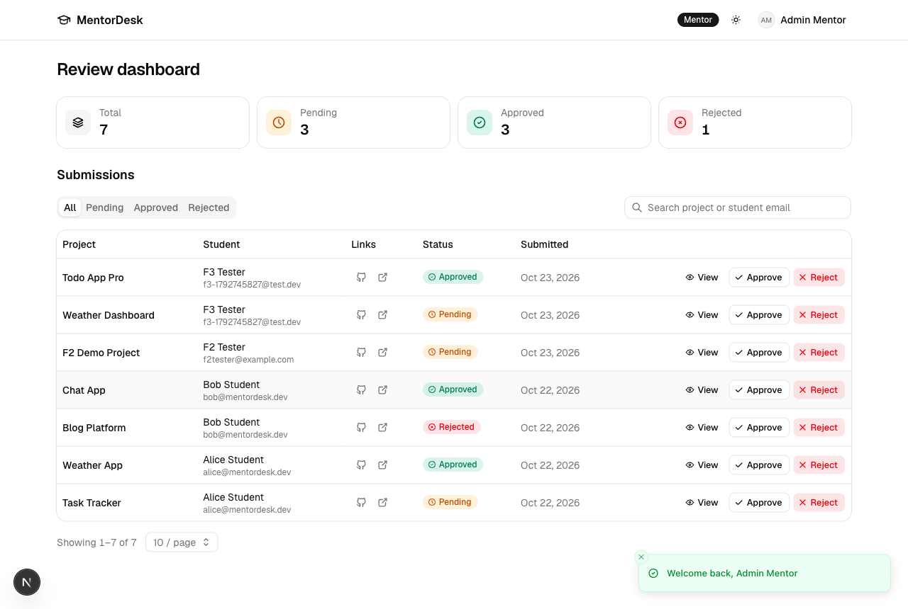
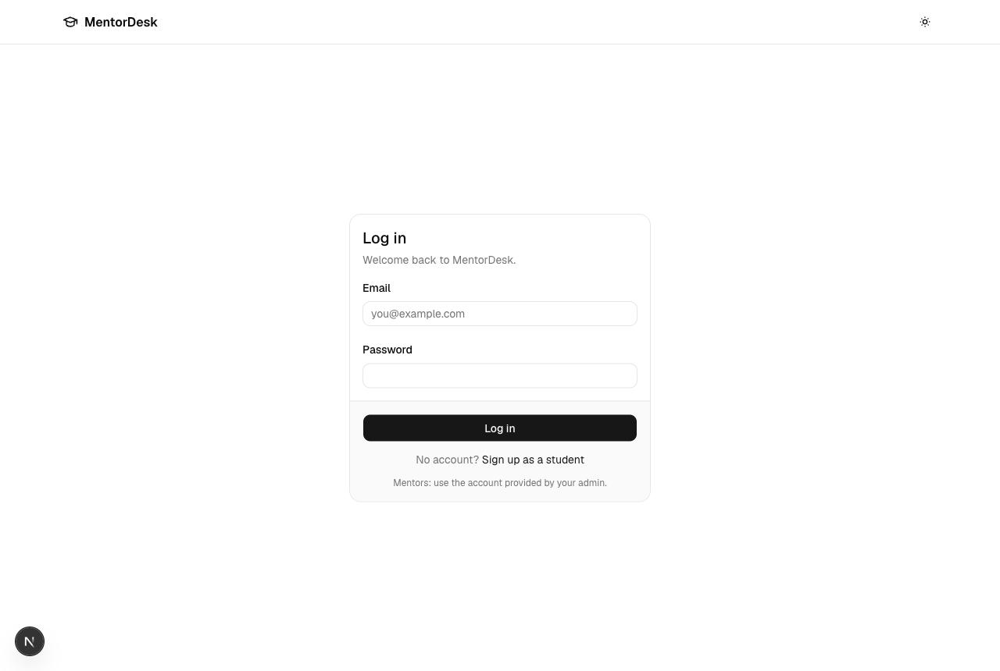
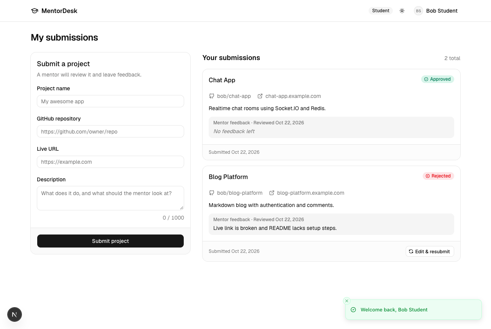
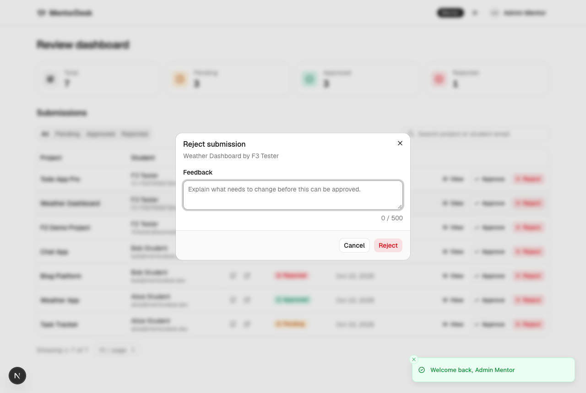
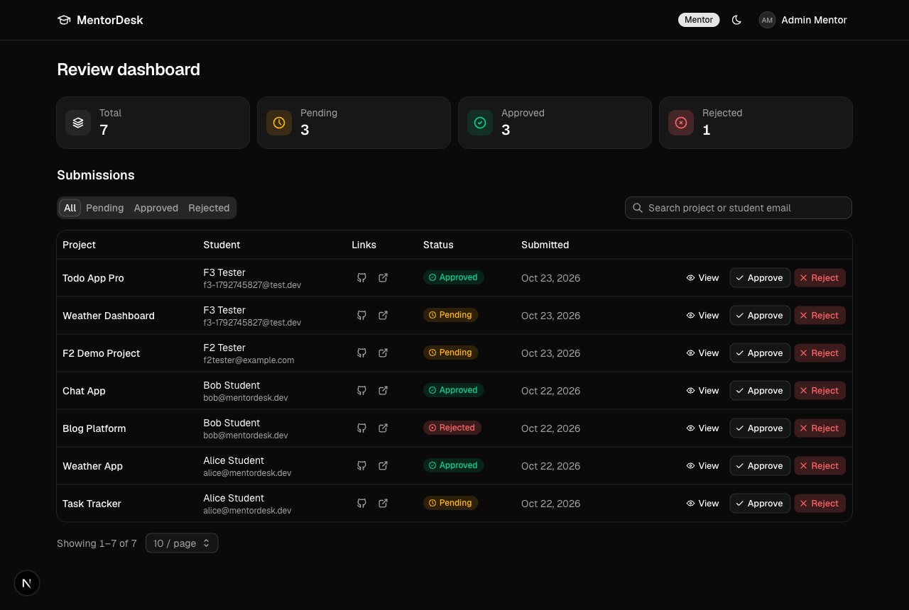
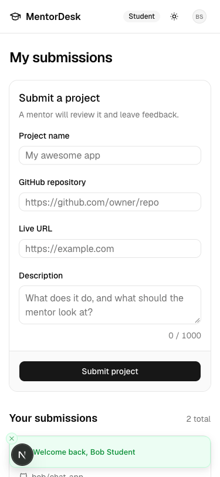
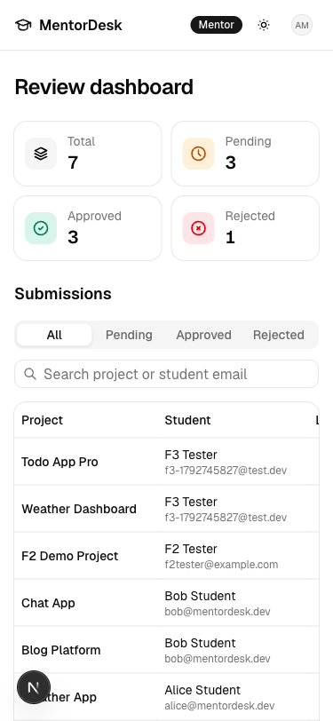
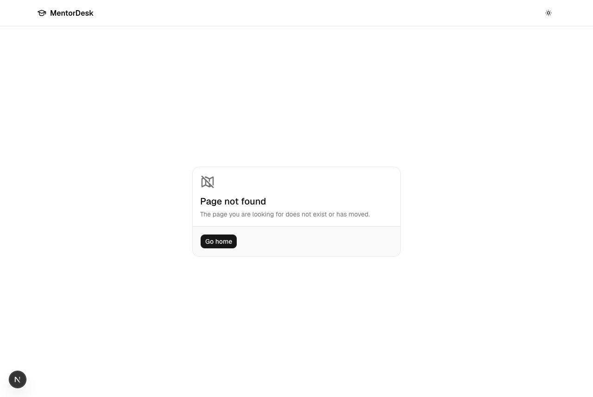

# MentorDesk Frontend

Next.js app for students to submit projects and mentors to review them. Talks to the MentorDesk Express API.



## Features

**Students**
- Sign up, log in, log out
- Submit a project (name, GitHub repo, live URL, description) with validation that mirrors the backend
- See their own submissions with status, mentor feedback and review date
- Edit and resubmit a rejected submission

**Mentors**
- Stats cards: total, pending, approved, rejected
- Submissions table with status tabs, debounced search (project name or student email), pagination and page size, all kept in the URL
- View full submission details
- Approve or reject with feedback (required on reject); a decision can be changed later

**General**
- Role-based routing: students land on `/student`, mentors on `/mentor`
- Light and dark theme, responsive down to 375px
- Keyboard and screen-reader friendly: skip link, labelled fields with linked errors, focus-trapped dialogs
- Not-found and error pages

## Tech stack

Next.js 16 (App Router), React 19, TypeScript, Tailwind CSS 4, shadcn/ui on Base UI, Redux Toolkit + RTK Query, react-hook-form + zod, sonner, Tabler icons.

## Prerequisites

- Node.js 20+
- pnpm
- The MentorDesk backend running on http://localhost:5001 (with its database migrated and seeded)

## Setup

```bash
pnpm install
cp .env.example .env.local
pnpm dev
```

App runs on http://localhost:3000. Start the backend first.

## Environment

| Variable | Example | Purpose |
|---|---|---|
| `NEXT_PUBLIC_API_URL` | `http://localhost:5001/api/v1` | Backend API base URL. |

## Scripts

| Command | Purpose |
|---|---|
| `pnpm dev` | Start the dev server |
| `pnpm build` | Production build |
| `pnpm start` | Serve the production build |
| `pnpm lint` | Run ESLint |

## Accounts

- Students sign up at `/signup`.
- There is no mentor signup. Use the seeded mentor from the backend `.env` (`SEED_MENTOR_EMAIL` / `SEED_MENTOR_PASSWORD`), by default `mentor@mentordesk.dev` / `Mentor12345`.
- Seeding the backend with `SEED_DEMO=true` also creates demo students `alice@mentordesk.dev` and `bob@mentordesk.dev` with password `Student123`.

## Project structure

```
src/
  app/                 routes: (auth)/login, (auth)/signup, student, mentor, error and not-found pages
  components/
    auth/              login/signup forms, route guards
    submission/        student form, list, cards, resubmit dialog
    review/            mentor dashboard, table, toolbar, pagination, review dialogs
    layout/            header, containers, theme toggle, error states
    ui/                shadcn components
  hooks/               cooldown, logout, review URL params
  lib/                 API errors, formatting, routes, zod schemas
  store/api/           RTK Query base API and endpoints
  types/               shared API types
  proxy.ts             redirects unauthenticated requests to /login
```

## Screenshots

| Login | Student |
|---|---|
|  |  |

| Review dialog | Dark mode |
|---|---|
|  |  |

| Student (mobile) | Mentor (mobile) | Not found |
|---|---|---|
|  |  |  |
